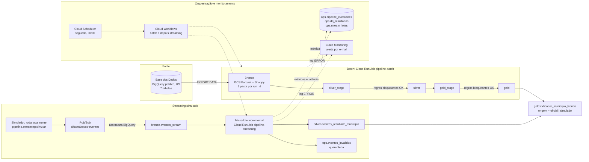

# Pipeline Híbrido para Análise da Alfabetização no Brasil

Tech Challenge, Fase 2 (POS TECH). Pipeline de dados **batch + streaming** no **Google Cloud**, em
**arquitetura medalhão**, sobre o dataset `br_inep_avaliacao_alfabetizacao` da Base dos Dados.
Tudo o que está descrito aqui foi **executado na nuvem**, com evidências em `docs/evidencias/`.

**Vídeo executivo:** *link a ser adicionado após a gravação.*

---

## 1. Contexto do problema

O **Compromisso Nacional Criança Alfabetizada** mobiliza União, estados, DF e municípios para que as
crianças estejam alfabetizadas até o fim do **2º ano do ensino fundamental**. Em 2023, a Pesquisa
Alfabetiza Brasil (INEP) definiu o corte de **743 pontos** na escala do Saeb. O **Indicador Criança
Alfabetizada** é o percentual de alunos que atingem esse patamar.

**Como o indicador é usado:**
- **Acompanhar a política ano a ano:** cada ente (Brasil, UF e município) tem uma trajetória de metas anuais até 2030.
- **Comparar territórios e redes:** municipal, estadual e pública.
- **Direcionar apoio a quem está mais longe da meta.**

Este projeto entrega esse indicador de forma confiável e auditável: recalculado a partir dos microdados, conferido contra o número oficial e comparado com a meta no mesmo recorte.

A política tem duas leituras de meta para 2030, e este projeto as mantém separadas:

| Leitura | Valor | Onde aparece |
|---|---|---|
| **Meta pactuada** (trajetória anual da fonte, 2024 a 2030) | 80% para a rede pública em 2030 | `meta_ano` e `meta_2030_pactuada` em `gold.meta_vs_resultado`; toda distância até a meta usa esta leitura |
| **Universalização** (aspiração da política) | 100% | Só a coluna `meta_2030_aspiracional`, identificada como cenário |

### Resultados principais (medidos)

| Pergunta | Resposta |
|---|---|
| O recálculo a partir dos microdados bate com o oficial? | **Sim.** Brasil 2024: **59,20%** recalculado contra **59,2%** publicado (diferença de 0,0004 pp). UFs: erro mediano de 0,004 pp. Municípios: 99,3% a 99,8% a menos de 1 pp |
| O Brasil atingiu a meta? | **2024: não** (59,2% contra 59,9%). **2025: sim** (66% contra 63,8%) |
| Quantos municípios atingiram a meta de 2024? | **2.788 (51,2%)**; 2.444 não atingiram (44,9%); 216 sem meta (4,0%) |
| E as UFs, em 2024? | 11 atingiram, 13 não atingiram e 1 sem meta (AC). Maior taxa: CE, com 85,3%. Maior distância: RS, com 44,7% contra uma meta de 66,2% |

---

## 2. Arquitetura implementada



**Uso das seis entidades obrigatórias** (e do dicionário):

| Entidade | Tabela | Onde é usada |
|---|---|---|
| Dados de alunos | `alunos` | Taxa recalculada (validação cruzada), proficiência média ponderada, features |
| Município | `municipio` | `gold.indicador_municipio`, meta × resultado municipal, features |
| UF | `uf` | `gold.indicador_uf`, meta × resultado estadual |
| Meta Brasil | `meta_alfabetizacao_brasil` | `gold.indicador_brasil` (taxa nacional publicada) e meta × resultado nacional |
| Meta por UF | `meta_alfabetizacao_uf` | Meta × resultado estadual |
| Meta por município | `meta_alfabetizacao_municipio` | Meta × resultado municipal, features (`f_meta_ano_alvo`, participação, nível) |
| Dicionário | `dicionario` | Tradução dos códigos de rede (`silver.dim_rede`) |

---

## 3. Tecnologias

| Componente | Tecnologia | Por quê |
|---|---|---|
| Nuvem | Google Cloud (projeto único) | A fonte já está no BigQuery: sem download, sem egress, sem multicloud |
| Bronze | Cloud Storage (Parquet + Snappy) + tabelas externas | Histórico imutável e barato, consultável por SQL |
| Silver e Gold | BigQuery | SQL, joins e particionamento; serve dashboards e ML |
| Mensageria | Pub/Sub + assinatura BigQuery | Entrega "pelo menos uma vez" gravada direto na Bronze do streaming, sem consumidor dedicado |
| Execução | Cloud Run Jobs (imagem do `Dockerfile`) | Paga só o tempo de execução; mesma imagem para batch e streaming |
| Orquestração | Cloud Workflows + Cloud Scheduler | Dependência entre etapas (o streaming só roda se o batch passar) e agendamento |
| Monitoramento | Tabelas `ops` + Cloud Logging + Cloud Monitoring | Métricas persistidas e alerta por e-mail |
| Código | Python 3.11+ (testado com 3.13 na imagem e 3.15 no Windows), SQL | `google-cloud-bigquery`, `google-cloud-storage`; Pub/Sub e Monitoring via API REST |

**Implementado × evolução futura**

| Implementado e executado | Planejado para a próxima etapa (não existe no repositório) |
|---|---|
| Batch, streaming simulado, qualidade, Gold, orquestração, alerta, medições de custo, testes unitários (`tests/`) | Infraestrutura como código (Terraform) |
| | CI (execução automática de testes a cada push) |
| | Expiração automática dos datasets de stage e ciclo de vida no bucket |
| | Exportação da Bronze só quando a fonte mudar |
| | Retentativa automática para erros transitórios |

---

## 4. Estrutura do repositório

```
pipeline/            código Python do pipeline
  bronze.py          ingestão batch -> Bronze (GCS)
  silver.py          Silver: stage -> qualidade -> publicação
  gold.py            Gold: stage -> qualidade -> publicação
  camadas.py         padrão comum de construir/publicar
  qualidade.py       regras bloqueantes e informativas (Silver, Gold, streaming)
  streaming.py       simulador (produtor) e micro-lote (consumidor)
  metricas.py        métricas por etapa em ops.pipeline_execucoes
  run.py             ponto de entrada do batch
  setup_infra.py     bucket, datasets e tabelas ops
  setup_streaming.py tópico, assinatura e tabelas do streaming
  setup_alerta.py    política de alerta por e-mail
  pubsub_rest.py     cliente REST do Pub/Sub
sql/silver/          SQL da Silver (1 arquivo por tabela)
sql/gold/            SQL da Gold
sql/streaming/       SQL do micro-lote
orquestracao/        workflow.yaml, cloudbuild.yaml, implantar.cmd
scripts/             explorar.py, medir_custos.cmd, finops_medicoes.sql
tests/               testes automatizados (pytest)
docs/                FINOPS.md, evidencias/
Dockerfile           imagem dos Cloud Run Jobs
config.example.toml  modelo de configuração
requirements.txt     dependências com versão fixa
```

---

## 5. Como executar

Os comandos abaixo são para o **Windows (Prompt de Comando)**. No Linux ou Mac, troque `.venv\Scripts\activate.bat` por
`source .venv/bin/activate`, `copy` por `cp` e `set X=Y` por `export X=Y`.

### 5.1 Pré-requisitos

- Python 3.11 ou superior e o [Google Cloud CLI](https://cloud.google.com/sdk/docs/install)
- Projeto GCP **com faturamento ativo** (o `MERGE` do streaming e o Pub/Sub não funcionam no sandbox)

### 5.2 Configuração (um único lugar)

Projeto e bucket são lidos das variáveis de ambiente `GCP_PROJECT` e `GCS_BUCKET`. Se elas não
existirem, o pipeline lê o arquivo `config.toml`. Os scripts `.cmd` usam só as variáveis de ambiente.
Nenhuma credencial fica no repositório: a autenticação é a do `gcloud`.

```cmd
gcloud auth login
gcloud auth application-default login
gcloud config set project SEU-PROJETO
gcloud services enable bigquery.googleapis.com storage.googleapis.com pubsub.googleapis.com

python -m venv .venv
.venv\Scripts\activate.bat
pip install -r requirements.txt

copy config.example.toml config.toml
set GCP_PROJECT=SEU-PROJETO
set GCS_BUCKET=SEU-BUCKET-UNICO
```

### 5.3 Batch (Bronze → Silver → Gold)

```cmd
python -m pipeline.setup_infra
python -m pipeline.run
```

| Comando | Para quê |
|---|---|
| `python -m pipeline.run` | Execução completa: Bronze, Silver e Gold |
| `python -m pipeline.run --etapas silver,gold` | Reconstrói Silver e Gold a partir da última Bronze completa, sem reexportar a fonte |
| `python -m pipeline.run --etapas silver --forcar-falha` | **Demonstra a falha:** uma regra bloqueante reprova, a Silver não é publicada e o processo termina com código 1 |

### 5.4 Streaming simulado

```cmd
python -m pipeline.setup_streaming
python -m pipeline.streaming simular --eventos 300 --por-segundo 5
python -m pipeline.streaming processar --lotes 4 --intervalo 30
```

Rode `simular` e `processar` em **dois terminais** ao mesmo tempo para ver os lotes pegando os
eventos à medida que chegam.

### 5.5 Orquestração na nuvem e alerta

```cmd
orquestracao\implantar.cmd seu-email@exemplo.com
gcloud workflows run pipeline-alfabetizacao --location=us-central1
```

O `implantar.cmd` ativa as APIs, cria três contas de serviço com permissão mínima, constrói a imagem
(Cloud Build), cria os dois Cloud Run Jobs, o workflow, o agendamento semanal e o alerta. Ele pode
ser executado de novo sem problema. Para testar o alerta:

```cmd
gcloud run jobs execute pipeline-batch --region=us-central1 --args=pipeline.run,--etapas,silver,--forcar-falha --wait
```

### 5.6 Testes e medições

```cmd
pytest
scripts\medir_custos.cmd
```

---

## 6. Decisões arquiteturais e trade-offs

**Forma de acesso à fonte: BigQuery nativo**
- **Por quê:** a fonte já está no BigQuery, na multirregião US. Ler direto evita baixar arquivos e manter um passo de upload.
- **Custo:** só os bytes lidos. A leitura da fonte inteira custa 268,5 MB por execução (dry run). Não há egress nem transferência entre nuvens, porque bucket e datasets também estão em US.
- **Quando a fonte for atualizada:** a próxima execução agendada exporta para um **novo `run_id`** na Bronze e reconstrói Silver e Gold. As versões anteriores continuam no bucket.

**Batch × streaming**

| | Batch | Streaming (simulado) |
|---|---|---|
| Dado | Histórico oficial completo (7 tabelas) | Eventos de resultado preliminar por município |
| Frequência | Semanal (a fonte muda no máximo uma vez por ano) | Micro-lotes sob demanda (testado a cada 15 e 30 s) |
| Latência | Horas a dias (até o próximo agendamento) | Medida: 34 ms até o Pub/Sub; cerca de 22 s até a Gold (p95 de 28 s) |
| Garantias | Execução atômica: a camada só é publicada se todas as regras passarem | Entrega "pelo menos uma vez": dedup por `event_id`, quarentena de inválidos, livro-razão por `message_id` |
| Custo por execução | 1,88 GiB no BigQuery + 332 s no Cloud Run | 210 MiB + cerca de 97 s com mensagens; 50 MiB + 60 s sem mensagens |

**Data lake × data warehouse**
- **Bronze no lake** (GCS, Parquet): é imutável, barata e independente do BigQuery. Tabelas externas permitem consultá-la por SQL.
- **Silver e Gold no warehouse** (BigQuery): os joins, as regras de qualidade e o consumo analítico são SQL, e o BigQuery cobra por bytes lidos, o que favorece tabelas particionadas e clusterizadas.

**Custo × performance**
- Preço on-demand, sem slots reservados: o volume é de cerca de 2 GB por semana.
- Particionamento (`silver.alunos` por ano) e clusterização (UF e município).
- Publicação por **cópia de tabela**, que é gratuita, em vez de reprocessar.
- Trava de custo: **dry run** antes de cada consulta e `maximum_bytes_billed`, que impede qualquer consulta acima de 5 GB.

**Política de escrita por camada**
- **Bronze: histórico preservado.**
    - Cada execução grava em `bronze/<tabela>/ingestion_date=AAAA-MM-DD/run_id=<run_id>/`.
    - O código verifica que o caminho está vazio antes de exportar, e o `EXPORT DATA` usa `overwrite = false`. Nada é sobrescrito nem apagado.
    - As tabelas `bronze.*` são externas, particionadas por `ingestion_date` e `run_id`, sobre todas as execuções. O `CREATE OR REPLACE EXTERNAL TABLE` redefine só o metadado, e os arquivos não são tocados.
- **Silver e Gold: retratos derivados.**
    - Cada execução reconstrói as tabelas (`CREATE OR REPLACE`) nos datasets `*_stage`.
    - As regras rodam sobre o stage, e só depois as tabelas são copiadas (`WRITE_TRUNCATE`) para `silver` e `gold`.
    - O histórico está na Bronze, então qualquer versão pode ser reconstruída com `--bronze-run-id`.
- **Streaming: append idempotente.**
    - Bronze em append (assinatura do Pub/Sub).
    - Silver e quarentena por `MERGE` (`WHEN NOT MATCHED THEN INSERT`), o que torna o reprocessamento seguro.

**Tratamento de chaves e de ausentes (Silver)**
- **Códigos de rede:** traduzidos pela tabela oficial `dicionario`. As metas usam rótulos em texto, mapeados explicitamente em `sql/silver/02_map_rede_meta.sql` (`Municipal` → 3, `Pública` → 5).
- **UF:** obtida pelo prefixo IBGE do município.
- **Código ou rótulo desconhecido:** vira `desconhecido`, e uma regra bloqueante exige contagem zero.
- **Nulos são preservados; nulo nunca vira zero.** Um teste automatizado garante isso no SQL.
- **`alfabetizado` recalculado só para alunos avaliados** (presentes, prova preenchida, com proficiência e peso). A fonte marca os ausentes como "não alfabetizado" (seção 11).

---

## 7. Camada Gold

| Tabela | Conteúdo |
|---|---|
| `indicador_municipio` | Taxa oficial (INEP) e recalculada dos microdados por município, ano e rede; avaliados, soma dos pesos, níveis de proficiência e variação em relação ao ano anterior |
| `indicador_uf` | O mesmo por UF. O recalculado agrega **alunos** ponderados pelo peso, nunca média de municípios |
| `indicador_brasil` | Taxa nacional publicada × recalculada a partir de todos os alunos avaliados do país |
| `meta_vs_resultado` | Resultado × meta **no mesmo recorte de rede e série** (município: rede municipal; UF e Brasil: rede pública), com `status_meta` ∈ {`atingiu`, `nao_atingiu`, `sem_meta`, `sem_resultado`} e distância até as metas de 2030 pactuada e aspiracional |
| `resumo_meta` | Quantidade e percentual em cada estado, por nível e ano |
| `validacao_recalculo` | Erro médio, mediano, p95 e máximo do recalculado × oficial, com e sem peso amostral |
| `features_municipio` | Base para a Fase 3 (seção 10) |
| `indicador_municipio_hibrido` | Oficial e simulado juntos, separados pela coluna `origem` |

**Regras de cálculo**
- **Denominador:** alunos avaliados, ponderados por `peso_aluno`. Sem o peso, o erro nas UFs sobe de 0,004 para cerca de 0,5 pp.
- **Meta vigente no ano Y:** a meta para Y da publicação mais recente **anterior** a Y. Em 2023, ano da linha de base, não há meta vigente.
- **"Sem meta" é um estado próprio** e nunca é contado como "não atingiu".

---

## 8. Qualidade de dados

São 46 regras (26 na Silver, 14 na Gold e 6 no streaming), em `pipeline/qualidade.py`. Cada execução
grava **todas** as regras em `ops.dq_resultados` (append) antes de decidir. Se alguma **bloqueante**
reprovar, a exceção sobe sem ser capturada, a camada não é publicada e o processo termina com código 1.

| Tipo | Exemplos |
|---|---|
| Bloqueante | Duplicidade de chave; código fora do dicionário; município sem UF; formato do código IBGE; proficiência fora da escala; peso ≤ 0; meta fora de 0 a 100; status de meta inválido; **taxa de correspondência de cada join** |
| Informativa | Percentual de não avaliados; ausentes marcados como "não" na fonte; UFs sem resultado; diferença entre recalculado e oficial |

**Taxa de correspondência dos joins** (obrigatória)

| Join | Limiar | Medido | Justificativa do limiar |
|---|---|---|---|
| Alunos avaliados → resultado por município | 0,90 | **99,93%** | O INEP pode suprimir municípios com poucos avaliados, então 100% não é esperado; abaixo de 90% indica chave quebrada |
| Meta municipal → resultado municipal (rede 3) | 0,95 | **99,53%** | Mesmo universo; perda alta indica erro de chave ou de rede |
| Meta de UF → resultado de UF (rede 5) | 0,85 | **90,74%** | DF e RR não existem na tabela `uf` da fonte (25 de 27 = 92,6%) |

**Falha demonstrada:** `--forcar-falha` eleva o limiar do último join para 1,0. A execução
`20261021T120755Z` terminou com `FalhaBloqueante`, código de saída 1 e nenhuma tabela publicada
(registrado em `ops.pipeline_execucoes`). O mesmo teste foi repetido na nuvem (Cloud Run, execução
`pipeline-batch-zqzbl`).

---

## 9. Monitoramento

| Requisito | Como é atendido |
|---|---|
| Métricas persistidas | `ops.pipeline_execucoes`: duração, linhas de entrada e saída, bytes faturados e status **por etapa**, em append |
| Resultado das validações | `ops.dq_resultados`, em append |
| Latência medida | `ops.stream_lotes`: `event_time` (produtor), `publish_time` (Pub/Sub) e `processado_em` (`CURRENT_TIMESTAMP()` no `MERGE`), três carimbos de origens diferentes |
| Volume processado | Linhas e bytes por etapa; mensagens novas, inseridas, duplicadas e inválidas por micro-lote |
| Alerta de erro | Política baseada em log no Cloud Monitoring: qualquer log `ERROR` dos jobs ou do workflow envia e-mail, no máximo 1 a cada 5 minutos |

**Em produção, quem descobre que o pipeline quebrou, e em quanto tempo?** O responsável cadastrado
recebe um e-mail do Cloud Monitoring. No teste, a falha forçada no Cloud Run terminou às 21:37:20
UTC, e o e-mail chegou com início do incidente às 21:38 UTC: **cerca de 1 minuto**. O texto do alerta
indica onde investigar (Logs Explorer, `ops.pipeline_execucoes` e `ops.dq_resultados` pelo `run_id`).

**A latência é medida de verdade.** Na primeira rodada, a latência de ingestão deu −2,8 s. O
relógio do computador que gerava os eventos estava cerca de 3 s adiantado em relação ao do Google.
Depois de sincronizar o relógio, a medida foi de +34 ms. O carimbo do produtor e o da ingestão vêm
de relógios diferentes, e a métrica detectou isso.

---

## 10. Aplicação em IA

A Gold foi preparada para três usos:

- **Predição de alfabetização:** `gold.features_municipio` tem uma linha por município (rede municipal) e ano base, com as entradas `f_*` e os alvos `alvo_taxa` (taxa do ano seguinte) e `alvo_atingiu_meta`. Hoje são 5.396 municípios, com entradas de 2023 e alvo de 2024.
- **Análise de desigualdade:** `indicador_municipio` e `indicador_uf` têm a distribuição por nível de proficiência e a região, o que permite comparar territórios e redes no mesmo recorte.
- **Políticas públicas:** `meta_vs_resultado` mostra quem está atrás da meta pactuada e a que distância. É um critério objetivo para priorizar apoio técnico.

**Vazamento de alvo (cuidado aplicado)**
- As colunas `f_*` usam **só o que se sabe ao fim do ano base**: o resultado do ano base, a participação e o nível publicados no ano base, e a meta do ano alvo, que é publicada antes.
- A tabela de metas publicada **no ano alvo** traz a taxa do próprio ano alvo, ou seja, o alvo. Por isso ela não entra como entrada.
- **Use um único alvo por modelo.** `alvo_atingiu_meta` é derivado de `alvo_taxa`: é verdadeiro quando `alvo_taxa >= f_meta_ano_alvo`. Usar um alvo como entrada para prever o outro produz exatamente o modelo que "acerta tudo sem ter aprendido nada". Por isso nenhuma coluna `alvo_*` pode entrar como variável de entrada.
- `f_esforco_necessario_pp` (meta do ano alvo menos a taxa do ano base) usa só informação do ano base e a meta publicada antes, então não carrega o alvo.
- Um teste automatizado garante que toda coluna da tabela de features é identificador, `f_*` ou `alvo_*`.
- **Validação do modelo:** com um só par de anos, a validação deve ser feita por divisão entre municípios (por exemplo, por UF). Validar no tempo exige pelo menos um terceiro ano de resultado.

---

## 11. Investigação de anomalias da fonte

| Achado | Evidência | Conclusão |
|---|---|---|
| A coluna `alfabetizado` marca **ausentes como "não"** | 1.883.453 "não" + 1.984.546 "sim" = 3.867.999 registros, incluindo 512.153 ausentes | Usar a coluna direto daria cerca de 51%. A Silver recalcula só para avaliados, e o resultado bate com o INEP (59,2%) |
| DF e RR não existem na tabela `uf` | Regra `ufs_sem_resultado` | Limiar do join de UF ajustado e justificado; entram como `sem_resultado` |
| **O Acre não tem resultado em 2023** | Falta em `uf`; 50 metas municipais sem par, quase todas com código `1200…` | Lacuna da fonte; aparece como `sem_resultado` |
| Brasil 2023: recalculado 57,46% × publicado 55,9% (1,56 pp) | `gold.indicador_brasil` | UFs e municípios de 2023 batem, então a diferença está na agregação nacional. A hipótese é que o número publicado inclua unidades ausentes dos microdados de 2023 (como o Acre) ou use outra metodologia. **Investigação em aberto** |
| `caderno = 43` em 18 alunos (os demais vão de 1 a 21) | Regra `caderno_fora_1_21` | Registrado como informativo; não afeta o indicador |
| Só 25 alunos da rede privada | Regra `rede_privada_em_alunos` | Na prática, a amostra é da rede pública |

---

## 12. FinOps

Medições, preços e fontes estão em [`docs/FINOPS.md`](docs/FINOPS.md). A saída bruta está em
`docs/evidencias/finops/medicoes.txt`, gerada por `scripts/medir_custos.cmd`.

**Ambiente:** trial do Google Cloud, com tudo dentro das cotas gratuitas (fatura de R$ 0,00). Por
isso projetamos o mesmo desenho a **preço de lista**, na cadência implantada (semanal).

| Serviço | Unidade | Quantidade medida | Preço unitário (USD) | Custo mensal projetado (lista) |
|---|---|---|---|---|
| BigQuery: consultas | TiB processado | 1,88 GiB por batch; 50 MiB por micro-lote vazio | 6,25 / TiB | US$ 0,050 |
| BigQuery: armazenamento | GiB-mês | 1,058 GiB | 0,023 / GiB-mês | US$ 0,024 |
| Cloud Storage (Bronze) | GiB-mês | 74,6 MB por execução | 0,026 / GiB-mês | US$ 0,008 (US$ 0,094 no 12º mês) |
| Cloud Run Jobs | vCPU-s | 332 s (batch) + 60 s (streaming) | 0,000018 / vCPU-s + 0,000002 / GiB-s | US$ 0,034 |
| Cloud Workflows | passos | ~37 por execução | 0,01 / 1.000 | US$ 0,002 |
| Cloud Scheduler | job-mês | 1 | 0,10 | US$ 0,100 |
| Cloud Build | minuto | 45 s por build | 0,0061 / min | US$ 0,018 |
| Artifact Registry | GiB-mês | 64 MiB | 0,10 / GiB-mês | US$ 0,006 |
| **Total** | | | | **US$ 0,24/mês (R$ 1,44)**; após cotas gratuitas, US$ 0,01 |

- **Streaming a cada 15 minutos:** US$ 6,21/mês (R$ 36,84) a preço de lista. Nesse cenário, o custo é **fixo por lote**: mínimo de 10 MB por tabela no BigQuery e de 1 minuto no Cloud Run.
- **Efeito medido das práticas:**
    - Parquet + Snappy: Bronze **3,6x menor** que a fonte;
    - seleção de colunas: **−88%** de leitura;
    - seleção de colunas + filtro de partição: **−90%** de leitura.
- **Oportunidade identificada:** os datasets de stage são 49,9% do armazenamento do BigQuery.

**Como os custos são controlados no dia a dia**
- **Alerta de orçamento no Billing:** R$ 50 por mês, com e-mail ao atingir 50%, 90% e 100%. Ele mede o consumo bruto, sem descontar os créditos do trial; caso contrário, nunca dispararia.
- **Trava por consulta:** dry run antes de cada consulta e `maximum_bytes_billed` de 5 GB (`max_gb_por_query` no `config.toml`).
- **Bytes faturados por etapa** gravados em `ops.pipeline_execucoes`, para acompanhar a evolução do custo a cada execução.

---

## 13. Limitações conhecidas

- **O streaming é simulado.** Os eventos são gerados pelo `pipeline.streaming simular` a partir das taxas reais com variação aleatória, e sempre levam `origem = "simulado"`. O simulador roda na máquina local, e não na nuvem.
- **O micro-lote é disparado.** Ele roda por comando ou uma vez por semana no workflow, e não continuamente. A latência ponta a ponta inclui a espera até o lote seguinte.
- **A latência de ingestão depende de relógios sincronizados** (seção 9).
- **Só há dois anos de resultado (2023 e 2024).** Qualquer projeção até 2030 seria cenário, não previsão. A base de features tem um único par ano base → ano alvo.
- **A diferença de 1,56 pp do Brasil em 2023 não foi explicada** (seção 11).
- **Os jobs não têm retentativa automática** (`max-retries = 0`). Isso é proposital: uma regra bloqueante reprovada não deve ser repetida. Retentar erros transitórios fica para a próxima etapa.
- **Os scripts de implantação e medição são para Windows** (`.cmd`). Os comandos `gcloud` dentro deles funcionam igual em outros sistemas.
- **A Bronze reexporta a fonte inteira toda semana,** mesmo sem mudança (74,6 MB e 268,5 MB lidos por execução). Exportar só quando a fonte mudar está planejado (seção 3).
- **O alerta tem um único destinatário** (um e-mail). Em produção, o ideal seria um canal do time.
- **O ambiente é uma conta trial.** Os custos reais foram cobertos por cotas gratuitas; a tabela de FinOps projeta o preço de lista.
- **Não há Terraform nem CI** (planejado; seção 3).

---

## 14. Evidências de execução

| O quê | Identificador | Onde |
|---|---|---|
| Exploração da fonte (perfil das 7 tabelas) | — | `docs/evidencias/exploracao/` |
| Batch completo (local) | `run_id 20261021T115739Z` | `ops.pipeline_execucoes` |
| Falha bloqueante demonstrada (local) | `run_id 20261021T120755Z` | `ops.pipeline_execucoes`, `ops.dq_resultados` |
| Gold publicada | `run_id 20261021T123426Z` | `ops.pipeline_execucoes` |
| Streaming: 300 eventos (267 inseridos, 17 duplicados, 16 inválidos) | lotes `20261021T190604Z` e `20261021T190742Z` | `ops.stream_lotes`, `ops.stream_mensagens` |
| Streaming após sincronizar o relógio (ingestão de 34 ms) | lote `20261021T204059Z` | `ops.stream_lotes` |
| Build da imagem | `57870110-2f3d-4d5a-ab6a-0250e8838357` (SUCCESS, 45 s) | Cloud Build |
| Orquestração completa na nuvem | Workflows `606bd526-e4ce-4a0c-8529-d1f1d5c5d673` (SUCCEEDED, 495,6 s); jobs `pipeline-batch-sbfpw` e `pipeline-streaming-x56tk` | Cloud Workflows, Cloud Run |
| Falha forçada na nuvem e e-mail de alerta | `pipeline-batch-zqzbl` | Cloud Run, Cloud Monitoring |
| Medições de custo | — | `docs/evidencias/finops/medicoes.txt` |

Os prints de console e de terminal de cada etapa estão nas subpastas de `docs/evidencias/`.
